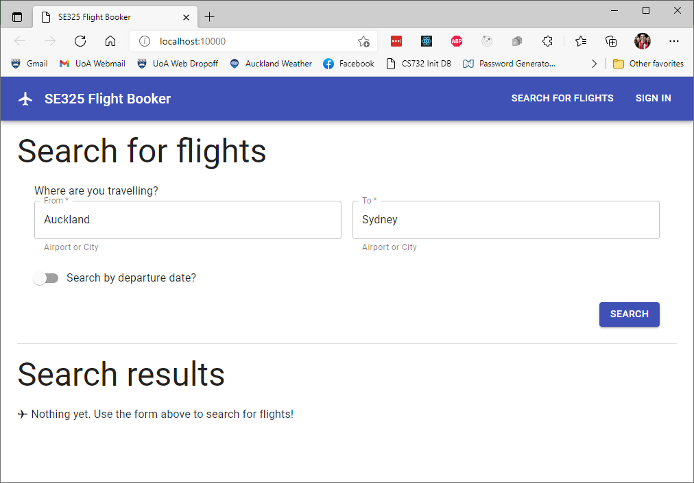
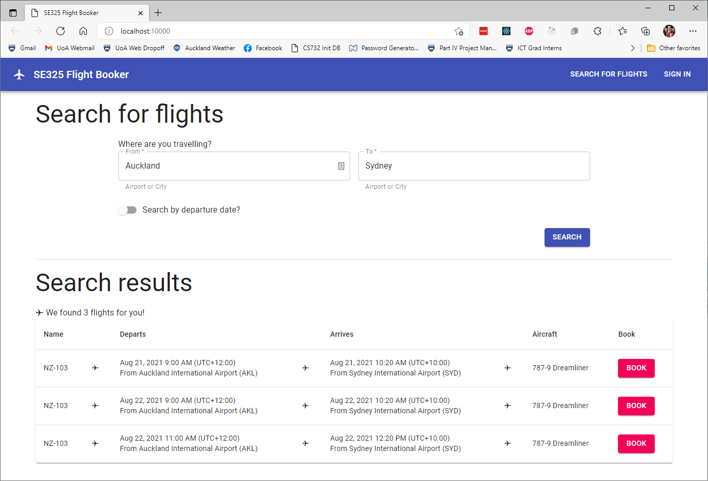
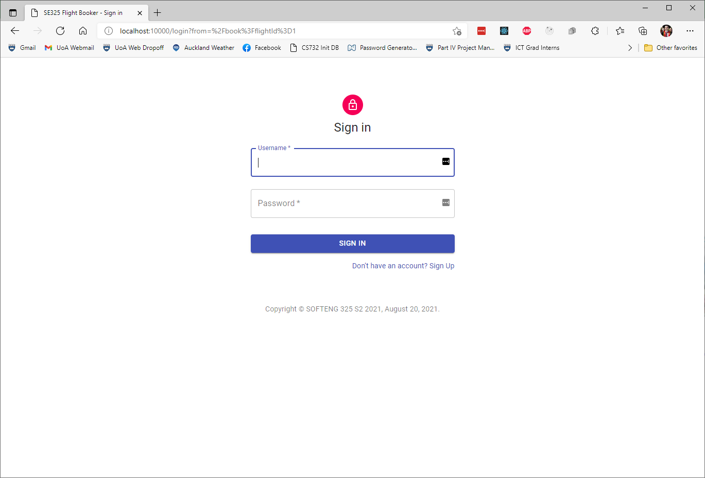
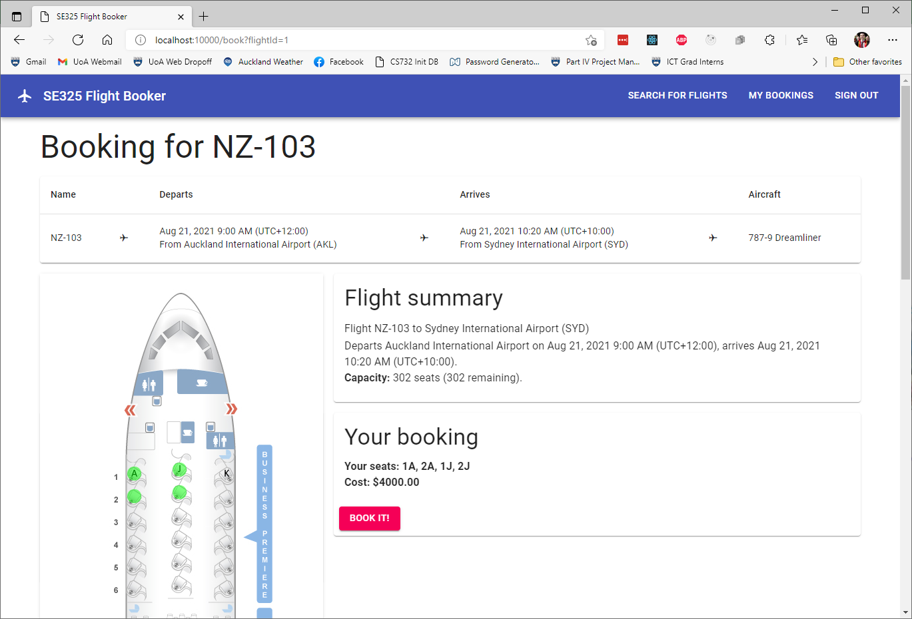
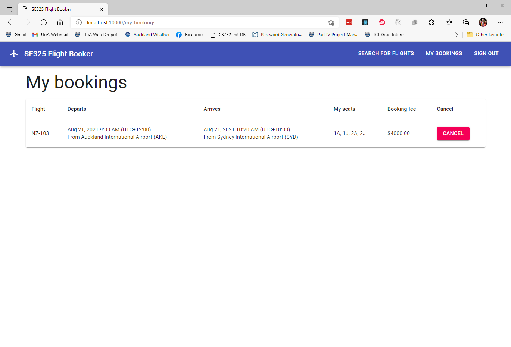
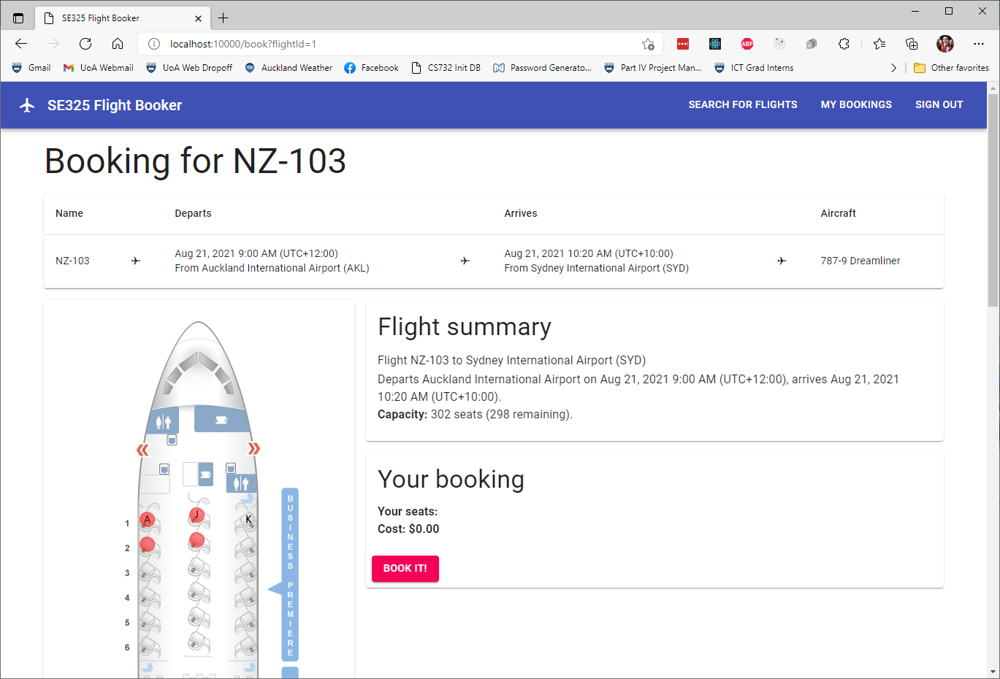

# SOFTENG 325 Assignment One - A Flight Booking Service

The aim of this assignment is to build a RESTful web service for querying and booking flights, using SpringBoot Web, Spring Data JPA / Hibernate, and related technologies you've learned in this course.

## IMPORTANT Note!

**This assignment is copyright © Andrew Meads, 2026. You may not publish _any_ of the provided files to venues including, but not limited to, online forums and public GitHub repositories. If we spot copies of this assignment - _even your solutions_ - online (even after this course is finished), we will seek to have them taken down.
** We really wish we didn't have to put this notice in, but we want to reuse this assignment in future iterations of the course, and do not want to have easily-searchable solutions to it online!

## System description

A booking service is required for a website which aggregates flights from several airlines, and airports, on several different kinds of aircraft. Anyone must be able to search for flights from / to particular origins / destinations, and optionally, by departure date.

Users must be able to create accounts with (unique) usernames and passwords. Once created, users should be allowed to log in and log out. While logged in, users must be able to book their desired seats on their chosen flights (assuming those seats aren't already taken). Seats on flights have a particular cabin class (e.g. Economy, Business, determined by the aircraft) and price (determined by the cabin class and the specific flight). Each seat on a flight must only be able to be booked once - i.e. double-bookings should be actively prevented. When requesting a booking, partial bookings can't be made - either *all* of a user's requested seats will be booked, or *none* of them will be. Authenticated users should also be able to query and cancel their own bookings.

A formalized definition of the REST interface that should be provided to clients is given below.

### REST interface

#### Users

- `POST /api/users`: Creates a new user account.
    - **Request payload**: JSON object containing a `username` and `password`
    - **Response codes**":
        - `201 Created` if success
        - `409 Conflict` if an account with the provided username already exists
    - **Response header**: A `Location` URI pointing to the newly created account, e.g. `/api/users/1`.

- `POST /api/users/login`: Logs an existing user into the system.
    - **Request payload**: JSON object containing a `username` and `password`
    - **Response codes**:
        - `204 No Content` if success
        - `401 Unauthorized` if a matching account doesn't exist.
    - **Response header**: Authentication cookie named `authToken`, to uniquely identify this user (if authentication successful). The cookie's value should be a signed JWT with the user's `username` and a unique `uuid` value as claims.

- `GET /api/users/logout`: Logs out a user.
    - **Response codes**:
        - `204 No Content`
    - **Response header**: Authentication cookie named `authToken`, with `maxAge` set to 0 (will cause the client to delete the cookie).

#### Flights

- `GET /api/flights`: Retrieves a list of flights matching provided search parameters.
    - **Request query params**:
        - `origin` and `destination` (compulsory): To be used in a string search on origin and destination airports' names (e.g. Auckland International Airport) and codes (e.g. AKL). The search will perform wildcard string matching and will match origins and destinations whose names or codes contain the given query params (
          case-insensitive).
        - `departureDate` (optional): A `LocalDate`. If supplied, the search will only match flights departing on the given date, *in the origin airport's timezone*.
        - `dayRange` (optional, defaults to 0): An integer. If `departureDate` is not supplied, this will be ignored. If
          `departureDate` *is* supplied, then this value will be used to extend the range of possible dates to search for. For example, a value of `0` will only match flights on the given `departureDate`. A value of `1` will also match flights the day before and the day after. A value of `2` will match flights up to two days before and two days after, etc.
    - **Response codes**:
        - `400 Bad Request` if `origin` or `destination` are not supplied, or if `departureDate` *is* supplied but is an invalid date, or if `dayRange` less than 0
        - `200 OK` otherwise
    - **Response payload**: A JSON array of flights, if the search was successful (even if 0 results are found). Each flight's JSON should contain info about the flight itself, as well as its aircraft type, and origin and destination airports. It should be of the following form:

        ```json
        {
          "id": 1,
          "name": "ZNJ-242",
          "departureTime": "2025-08-11T13:00:00",
          "arrivalTime": "2025-08-11T16:10:00",
          "flightStatus": "OnTime",
          "origin": {
            "id": 1,
            "name": "Auckland International Airport",
            "code": "AKL",
            "latitude": -37.008,
            "longitude": 174.792,
            "timeZone": "Pacific/Auckland"
          },
          "destination": {
            "id": 2,
            "name": "Sydney International Airport",
            "code": "SYD",
            "latitude": -33.946,
            "longitude": 151.177,
            "timeZone": "Australia/Sydney"
          },
          "aircraftType": {
            "id": 2,
            "name": "777-200ER"
          }
        }
        ```

- `GET /api/flights/{id}`: Retrieves information about a single flight with the given id, if it exists.
    - **Request path param**:
        - `id`: The id of the flight to check
    - **Response codes**:
        - `404 Not Found` if a flight with the given id doesn't exist
        - `200 OK` otherwise
    - **Response payload**: A JSON object containing the flight info, of the form described above.

- `GET /api/flights/{id}/booking-info`: Retrieves information about seat pricing and seats which have already been booked for a particular flight.
    - **Request path param**:
        - `id`: The id of the flight to check
    - **Response codes**:
        - `404 Not Found` if a flight with the given id doesn't exist
        - `200 OK` otherwise
    - **Response payload**: A JSON object containing booking info for the requested flight. The JSON should contain information about the flight's aircraft type, all currently-booked seat codes, and pricing info for different cabin classes on the aircraft. It should be of the following form:

        ```json
        {
          "aircraftType": {
            "id": 2,
            "name": "777-200ER"
          },
          "bookedSeats": [
            "1A", "1B", "2A", "2B"
          ],
          "pricingInfo": {
            "Business": 950,
            "Economy": 158
          }
        }
        ```

#### Bookings

- `POST /api/bookings`: Allows authenticated users to make bookings on flights.
    - **Request header**: Authentication cookie for the user
    - **Request payload**: A JSON object containing the id of the flight to book (`flightId` property), as well as a list of seat codes to book on that flight (`requestedSeats` property).
    - **Response codes**:
        - `401 Unauthorized` if not authenticated
        - `404 Not Found` if the requested flight doesn't exist
        - Either `404 Not Found` or `409 Conflict` (either is fine) if any of the requested seat codes are invalid or already booked
        - `201 Created` if the booking is successful
    - **Response header**: A `Location` URI pointing to the newly created booking.

- `GET /api/bookings`: Allows authenticated users to retrieve all of their own bookings.
    - **Request header**: Authentication cookie for the user
    - **Response codes**:
        - `401 Unauthorized` if not authenticated
        - `200 OK` otherwise
    - **Response payload**: A JSON array of objects corresponding to the authenticated user's bookings (even if that list is empty). The list should be sorted by departure date, in ascending order. Each object in the returned array should be of the following form:

    ```json
    {
      "id": 1,
      "bookedSeats": [
        "1A",
        "1B",
        "2A",
        "2B"
      ],
      "flight": "<full Flight JSON as described in /api/flights above>"
    }
    ```

- `GET /api/bookings/{id}`: Allows authenticated users to retrieve one of their own bookings.
    - **Request header**: Authentication cookie for the user
    - **Request path param**:
        - `id`: The id of the booking to retrieve
    - **Response codes**:
        - `401 Unauthorized` if not authenticated
        - `404 Not Found` if the requested booking does not exist or does not belong to the authenticated user
        - `200 OK` otherwise
    - **Response payload**: A single JSON object corresponding to the requested booking (if successful). See above for the required JSON format.

- `DELETE /api/bookings/{id}`: Allows authenticated users to cancel their bookings.
    - **Request header**: Authentication cookie for the user
    - **Request path param**:
        - `id`: The id of the booking to cancel
    - **Response codes**:
        - `401 Unauthorized` if not authenticated
        - `204 No Content` otherwise. Even if a user requests to cancel a booking that isn't theirs, `204` will be returned (but the database shouldn't be altered).

### Domain model

Much of the data used by the REST service should be persisted in a database, using Spring Data JPA / Hibernate. This means that you should create a set of JPA _entity_ classes, along with some value types where appropriate, to represent this data.

Examine the following points, and the REST service description above, to get an idea of the domain classes you need to create:

- **_Users_** have accounts in the database, including _usernames_ and _SHA3-256 Hashes of passwords_.

- **_Airports_** can be the _origin_ or _destination_ of **_Flights_**. Airports have a _name_, _code_, _latitude_, _longitude_, and _time zone_.
    - Timezones are entries in the [TZ Database](https://www.iana.org/time-zones) (e.g. "Pacific/Auckland" for Auckland's timezone).
    - A full list of valid timezeones can be found here: <https://en.wikipedia.org/wiki/List_of_tz_database_time_zones>.

- **_Aircraft types_** describe different kinds of aircraft on which a **_Flight_** can be taken. Aircraft have a name, and any number of _seating zones_ where passengers can sit.
    - _Seating zones_ hold information about one particular seating zone on an aircraft. This includes the _cabin class_ of those seats (e.g. Economy, Business), the _starting row number_, the _number of rows_, and the _valid seat letters_ for seats in that zone.
    - If, for example, a seating zone has two rows, starting at row 10, and the valid letter codes are "AJK", then the seats in that seating zone would be 10A, 10J, 10K, 11A, 11J, and 11K.
    - An aircraft's seating zones together collectively describe all the available seats on that aircraft.

- **_Flights_** can be taken by users. Flights have a _name_, an _origin_ and _destination_ airport, a _departure_ and _arrival time_ (which should be [`ZonedDateTime`](https://docs.oracle.com/javase/8/docs/api/java/time/ZonedDateTime.html) rather than `LocalDateTime` instances, to take different timezones into account), an aircraft type, a _cost_ of different kinds of seats (of different cabin classes) on that flight, and a list of **_Bookings_** which have already been made for that flight.

- **_Bookings_** can be made by a user for a flight. Each booking is associated with only one user and only one flight. Bookings should reference their associated user and flight, as well as contain a list of seats which have been booked.

## Project structure

### Main package

The project is given as a Maven project, with the root package `uoa.se325.assignment01`. Some of the following child packages already exist; others you should create:

- `auth`: Contains a `SecurityUtils` class which has many methods you can use to help with user authentication / JWTs. If you add any extra classes / interfaces / annotations for authentication, these should also be placed here.

- `controller`:
    - You'll see one existing class, `ForwardController`. This is required to properly enable client-side routing for the React frontend in this project. It will forward all unmatched routes, other than requests for static files, to `index.html`, allowing React Router's client-side routing to take over. For more info, see [this article](https://medium.com/@AlexanderObregon/how-to-use-spring-boot-to-serve-client-side-routing-apps-like-react-or-vue-a460f5f1ee1e). **Please do not delete or modify this class**, otherwise you may break the frontend.
    - Your `@RestController` classes should go here. You should create three of these, as per the REST service description above.

- `dto`: If you add any classes that you're using as Jackson / JSON data transfer objects, but are _not_ part of your JPA / Hibernate domain model, these should go here.

- `model`: Your JPA / Hibernate domain model classes should go here.

- `repository`: Any Spring Data repository interfaces you create should go here. We would expect that there would be _at least_ one per REST controller - Probably more.

- `utils`: Contains the `TimeZoneUtils` class. This may help you with implementing the functionality around searching for flights in a given date range.

- The base package has the following classes:
    - `Se325Assignment01Application`: The main class; you can run this application if you want to test the client webapp with your backend.
    - `ServletInitializer`: This allows you to deploy your app to Tomcat (though you shouldn't really need to).
    - `WebConfig`: Currently, this enables [CORS support](https://developer.mozilla.org/en-US/docs/Web/HTTP/Guides/CORS) which has been useful for development of the frontend for this project. You may need to modify this class when implementing authentication (see details in later sections), or if you need to add any additional config.

### Resource files

The `src/main/resources` folder contains the following:

- `static` folder: Contains the client web app, which is a compiled React application.
- `application.properties`: Spring properties file. This is currently setup to use an in-memory H2 database, and to drop the database and run the `db-init.sql` file every time the application starts. You shouldn't need to change these settings, though you can uncomment the last line if you want to see the SQL that Hibernate is executing.
- `db-init.sql`: This is used by both the tests and the main app to initialize the database. You should look at this file to see what table and column names to use. More on this below.
- `db-contents.json`: Some of the database contents, as JSON. This is used by the integration tests. Do not modify this, and do not try and import data from this file into your application.
- `db-to-json.js`: A script to create the `db-contents.json` file from `db-init.sql`. You don't need to touch this, but feel free to look if you're interested.

### Test files

The `src/test/java` folder contains several Spring / JUnit integration test files. As you build your application, more and more of these should pass. A 100% pass rate for the tests is a good indication that you have completed _most_ functionality. Do **not** modify these test files, or you will fail the assignment.

## Tasks

For this assignment, there are several tasks you must complete: Broadly, these are: *i)* completing the domain model,
*ii)* implementing the web service methods, and *iii)* writing a short reflective report.

### Task One: Complete the domain model

For your first task, design and implement your domain model classes in the `model` package. Take a look at the [**Domain model**](#domain-model) section above for a description of the kinds of domain classes you should implement.

**Before** moving on to Task Two, you should at least make sure the tests in `ContextIT` pass. These tests ensure that Spring starts without crashing, and that the SQL file can be executed successfully. If these fail, it is a good indication that your domain classes do not map properly to the provided SQL.

#### Hints / suggestions

- Take a look at `db-init.sql`. This contains the test data for the app, and so should give you a good idea of class and property names.
- You can't create a table named `USER`, as it is a reserved H2 keyword. So if you are creating a `User` class, perhaps annotate it with `@Table` to change the name.
- Table and column names have their casing changed in H2. For example, the `AIRCRAFT_TYPE` table in the SQL file maps to a class named `AircraftType`, and the `TIME_ZONE` column maps to a property named `timeZone`.
- You shouldn't need to use many `@Table` or `@Column` annotations to change names - if you name your classes and properties well, then the defaults should work in most cases.

### Task Two: Implement the REST controllers and Spring data repositories

Next, implement controller classes: `BookingController`, `FlightController`, and `UserController`, as per the [REST specification](#rest-interface) given above.

Along with these controllers, you will likely want to implement Spring Data repositories, and perhaps DTO classes in cases where your existing domain classes do not make good choices for method parameters or return values.

#### Hints / suggestions

##### Testing

There is one integration test file provided for each of the required controller classes. Reading these test files thoroughly is another excellent way of determining the functionality that is required.

Your final submission for this assignment must contain *non-modified* unit and integration tests. However, while developing your solution, you may wish to disable some tests so they don't run all the time. You may quickly and easily disable a particular test by commenting out that test's `@Test` annotation, or adding a `@Disabled` annotation. You may also ignore all the tests in a particular test class by adding the `@Disabled` annotation to the class itself, like so:

```java
import org.junit.jupiter.api.Disabled;

@Disabled
public class BookingControllerIT {

}
```

If you do ignore any test cases during development, **make sure you revert the files and ensure all tests pass prior to the final submission!**. Failure to do so *will* result in lost marks.

##### Authentication

For the login / logout / authentication check functionality, it is _highly_ recommended to use the methods in the `SecurityUtils` class rather than trying to roll your own. Authentication in this REST service _requires_ [JWTs](https://jwt.io/), and the unit tests check for a valid JWT with the correct info in the returned auth cookie! `SecurityUtils` already contains methods for you which utilize the [java-jwt](https://github.com/auth0/java-jwt) package to encode and decode JWTs and add them to auth cookies.

##### Implementation order

The following is a *suggestion* of the order in which to implement the service methods (though this is not required - you're free to implement the methods in any order you feel is appropriate):

User controller:

1. Login
2. Logout
3. User account creation

Flights controller:

4. Flight search
5. Retrieve booking info

Bookings controller:

6. Create a new booking
7. Retrieve all bookings
8. Retrieve a single booking
9. Delete a booking

Ensure each web method is implemented successfully (by running the appropriate integration tests), *before* you move on to the next one! This way, you'll have a better idea of where any bugs have been introduced.

**Note**: When developing your flight search endpoints, try to leverage JPQL as much as you can, rather than (for example) reading in all flights and filtering the list in Java.

### Research tasks

You are largely free to implement the service however you choose, provided it meets the provided specifications and all tests pass. However, when implementing _authenticated routes_ and _flight search_ specifically, you should look into various Spring features not taught in class.

#### Authenticated routes

For routes requiring authentication (such as making a flight booking) investigate Spring's [`HandlerMethodArgumentResolver`](https://www.baeldung.com/spring-mvc-custom-data-binder) functionality You can add custom annotations, which can be read by custom `HandlerMethodArgumentResolver` implementations to inject arbitrary data into your REST methods.

In my model solution, I was able to create a custom annotation and resolver like so:

```java

@Transactional
public void doSomething(@AuthenticatedUser User user) {

}
```

This would automatically load the authenticated user from the database for me, or return a `401 Unauthorized` response if not!

Alternatively, you could investigate and use [Spring Security](https://spring.io/projects/spring-security).

#### Flight (and other) searching

You are expected to make good use of Spring Data repository [Query Methods](https://docs.spring.io/spring-data/jpa/reference/jpa/query-methods.html) throughout your controller classes - particularly in your "flight search" logic.

Relatively complex queries - such as finding all bookings from a given user, then ordering the result according to the flight's departure time in ascending order, can be achieved with _a single appropriately-named query method_.

Where the query method syntax is not sufficient, you can use the [`@Query`](https://docs.spring.io/spring-data/jpa/reference/jpa/query-methods.html#jpa.query-methods.at-query) annotation to write arbitrary JQL or JPQL to perform arbitrarily complex queries, including those involving complex joins.

In general, you should be doing **_all_** of your filtering / sorting / etc using these mechanisms, rather than doing something like `findAll()` and doing filtering in Java. Doing this will result in _major_ mark loss.

### Task Three: Reflective report

Write a short reflective report, of _no more than three pages_. Include the report as a **single PDF file** in the root of your submission repository (i.e. the same spot as this README file). The report should contain the following sections (referencing code files and line numbers where appropriate):

1. **Fetch plans and strategies**: Identify all implicit and explicit uses of _lazy loading_ and _eager fetching_ within your web service. Justify why those choices are appropriate in those cases.

2. **Domain and DTO classes**:
    - Which of your _domain_ classes are you also using to transfer data between client and server? In those cases, did you need any Jackson annotations? Why / Why not?
    - On the other hand, for each of your DTO classes, why did you feel these were necessary?

3. **Authentication**: Describe how you implemented your authentication functionality, to enable protected REST endpoints (i.e. endpoints which require an authenticated user). Explain how another developer would be able to add a new protected REST endpoint in your project.

4. **Flight search**: Describe how you implemented your "search for flights by origin, destination AND departure date" logic, taking time zones and date ranges into account. Explain any Spring Data repository custom methods and `@Query`s you used.

5. **Generative AI**: How did you use Generative AI to help you complete this assignment? Which tool(s) and model(s) did you use? How helpful were they? Did you encounter any unexpected difficulties?

## Assessment and submission

### Submission

Your submission will be the latest commit to the `main` branch of your GitHub Classroom repository, as of the assignment due date. Make sure that your submission also includes your report, as a PDF.

### Assessment

Your assignment will be marked out of **100 marks**, which in total form **18%** of your grade for SOFTENG 325. The mark breakdown is as follows:

#### Code: 75 marks

- All tests in `ContextIT` pass: **5 marks**

- All tests in `UserControllerIT` pass: **10 marks**

- All tests in `FlightControllerIT` pass: **12 marks**

- All tests in `BookingControllerIT` pass: **12 marks**

- The provided web client functions correctly when running `Se325Assignment01Application` and browsing to <http://localhost:8080> (see [appendix](#appendix-the-web-client) below): **5 marks**

- Appropriate use of domain model annotations for eager fetching, lazy loading, and cascading persistence where required: **6 marks**

- Appropriate reusable mechanism for enabling protected REST endpoints is developed: **10 marks**

- Appropriate flight search algorithm is developed, leveraging the capabilities of JPQL: **10 marks**

- Code is generally tidy, well-commented, and easy to understand: **5 marks**

#### Report: 25 marks

- Fetch plans and strategies:
    - Use of eager fetching and lazy loading is clear, well-justified, and consistent with your code: **5 marks**
- Domain and DTO classes:
    - Description is well-justified and consistent with your code: **5 marks**
- Authentication:
    - Explanation of your approach is clear, and the reader can see how to add new protected methods using your approach: **5 marks**
- Flight search:
    - Clear explanation and consistent with your code: **5 marks**
- Generative AI:
    - Insightful discussion including both positive aspects and constructive criticism: **5 marks**
- Spelling, grammar, and clarity: _multiplier of report mark - between 60% - 100%_

#### Lab completion: 0.5 - 1.0 multiplier\*

There are five labs for the first part of SE325, which you must have attempted to a satisfactory standard prior to the due dates of those lab activities, as mentioned in the course introduction. Failure to do this will result in your grade for this assignment being reduced, at a rate of 10% per lab. If no labs were attempted, _you will receive a maximum of 50% of the total mark for this assignment_.

## Appendix: The web client

Included in the project, in the `src/main/resources/static` folder, is a React-based web frontend which leverages many of the web service methods you'll implement for this assignment. It can be run by starting `Se325Assignment01Application` and then browsing to <http://localhost:8080>. When you do, the webapp's homepage should be displayed.

The homepage should look like the following screenshot:



On the homepage, you may search for flights by origin and destination, and (optionally) by departure date. Upon clicking the "search" button, your results will be displayed below the search form:



Booking a flight requires authentication. You may sign in anytime using the button in the top-right corner of the app bar. Or, if you click the "book" button next to a flight while not authenticated, you'll be automatically be redirected to the sign-in page.

Here, you may use one of the test accounts (Alice // pa55word or Bob // 12345) or create your own by following the link on the page:



Once signed in, you may book flights. On the booking page, you can see a summary of the flight you're trying to book, along with a seat map of the aircraft. You can click on seats to select them for booking - they'll be highlighted green. You can deselect selected seats by clicking them again.



Once you've made your selection, you can make the booking. You'll be taken to a page showing all of your bookings. You can also access this page anytime from the app bar, while signed in. On this page, you can also cancel any of your bookings. doing so will cause the booking to be immediately removed from the table.



When making a booking, if some seats for that flight have already been booked (by you or someone else), you'll see those seats highlighted in red, and won't be able to select them.



When you're done, you can sign out using the button in the top-right corner of the app bar. You'll be redirected to the homepage if you're not already there.

**Note:** You should sign out before you quit the webapp. This is because the webapp doesn't account for the fact that the server's database would be cleared / re-initialized. This would lead the client to see a user as still being "signed in" the next time they use the app, when in fact, the server (with a cleared and re-initialized database) won't recognize the auth cookie. If you forget, you can just sign out first the next time you use the webapp, before trying to book something.

In a "real" webapp, this kind of login error would be detected and dealt with properly - but I had that feature on my "nice-to-have future work" list 😉
